# Distributed Dual-Node RC Telemetry & Motor Control Platform

[](https://www.st.com)
[](https://www.st.com)
[](https://github.com/PGK123123/stm32-rc-telemetry-car)

An embedded hardware & firmware prototype for a radio-controlled differential drive platform (rover/car). The system utilizes a distributed dual-node architecture: a handheld transmitter based on **STM32F401** and a motor control / receiver node based on **STM32G474**.

> **Project Status:** Proof-of-Concept & Firmware Prototype. Core telemetry packetization, differential steering kinematic translation, UART interrupt-driven state-machine parser, and 4-channel PWM motor driver logic are implemented and validated in firmware.

---

## Architecture Overview

```mermaid
flowchart LR
    subgraph TX [Transmitter Node - STM32F401CCU6]
        J[2-Axis Analog Joystick] -->|ADC1 Multi-ch DMA| MUX[Differential Drive Kinematics]
        MUX -->|Speed & Steering Vector| PKT[Packetizer & XOR Checksum]
        PKT -->|HAL_UART_Transmit 50ms| RF_TX[433MHz RF / Serial TX]
    end

    RF_TX -. Wireless / Serial Link .-> RF_RX

    subgraph RX [Receiver Node - STM32G474CEU6]
        RF_RX[433MHz RF / Serial RX] -->|UART RX Interrupt| FSM[4-State Packet Parser FSM]
        FSM -->|Verified Commands| DRV[Dual H-Bridge Motor Logic]
        DRV -->|4x PWM TIM3| MOT[Left & Right DC Motors]
    end
```



---

## Hardware & System Specification

| Node | MCU | Core | Clock | Peripherals Used | Role |
| :--- | :--- | :--- | :--- | :--- | :--- |
| **Transmitter** | **STM32F401CCU6** (BlackPill) | ARM Cortex-M4 | 84 MHz | `ADC1` (2-ch DMA), `USART1`, `SysTick` | Joystick sampling, differential drive kinematics, telemetry packet framing |
| **Receiver** | **STM32G474CEU6** | ARM Cortex-M4F | 170 MHz | `USART1` (Interrupts), `TIM3` (4-ch PWM) | Packet verification (FSM), H-bridge direction and PWM motor actuation |

---

## Telemetry Protocol & Framing

Packets are transmitted periodically every **50 ms** over the RF / serial link.

### 8-Byte Frame Structure

```
+-------------------+------+----------+-----------+----------+
|  Preamble (4 B)   | SOF  | Left Cmd | Right Cmd | Checksum |
| 0x55 0x55 0x55 0x55 | 0xAA | (0..200) | (0..200)  |  (1 B)   |
+-------------------+------+----------+-----------+----------+
```

1. **Preamble (`0x55 0x55 0x55 0x55`)**: Alternating bit pattern (`01010101`) to stabilize receiver automatic gain control (AGC) and clock recovery on raw 433 MHz RF modules.
2. **Start of Frame (`0xAA`)**: Marks the beginning of the telemetry payload.
3. **Left Motor Command (`0..200`)**: Center / Stop = `100`, Full Reverse = `0`, Full Forward = `200`.
4. **Right Motor Command (`0..200`)**: Center / Stop = `100`, Full Reverse = `0`, Full Forward = `200`.
5. **CRC Checksum (1 Byte)**: Simple XOR validation:
   $$	ext{Checksum} = 	ext{LeftCmd} \oplus 	ext{RightCmd} \oplus 0	ext{xAA}$$

---

## Firmware Implementation Details

### 1. Transmitter (`transmitter_f401`)
- **Analog Acquisition**: Uses `ADC1` with circular DMA buffer to sample X and Y joystick pots without CPU overhead.
- **Differential Kinematics**:
  Translates linear forward/backward velocity ($V$) and rotational turn angle ($\omega$) into independent left and right wheel speeds:
  $$	ext{Speed}_L = V + \omega, \quad 	ext{Speed}_R = V - \omega$$
  Clamped to $[-100, +100]$ and offset by $+100$ into range $[0, 200]$.

### 2. Receiver & Motor Driver (`receiver_g474`)
- **Robust FSM Parser**: Driven entirely inside `HAL_UART_RxCpltCallback`. Rejects out-of-sync frames and corrupted payloads:
  - `STATE_IDLE`: Hunts for `0xAA` (SOF byte).
  - `STATE_GET_L`: Stores left motor byte.
  - `STATE_GET_R`: Stores right motor byte.
  - `STATE_GET_CRC`: Verifies XOR checksum. If valid, updates motor setpoints; if invalid, drops frame.
- **H-Bridge Control**: Converts offset $[0, 200]$ commands into directional logic (Forward, Reverse, Coast/Brake) and computes PWM duty cycle for `TIM3` channels.

---

## Directory Structure

```
stm32-rc-telemetry-car/
├── transmitter_f401/          # STM32F401 BlackPill remote control firmware
│   ├── Core/
│   │   ├── Inc/               # main.h, stm32f4xx_hal_conf.h
│   │   └── Src/               # main.c (ADC DMA + Packetizer)
│   └── car.ioc                # STM32CubeMX hardware configuration
└── receiver_g474/             # STM32G474 motor control receiver firmware
    ├── Core/
    │   ├── Inc/               # main.h, stm32g4xx_hal_conf.h
    │   └── Src/               # main.c (UART RX FSM + TIM3 PWM Driver)
    └── g474car.ioc            # STM32CubeMX hardware configuration
```

---

## Development Roadmap & Next Steps

- [ ] Hardware failsafe watchdog: Auto-stop motors if no valid packet received within 250 ms.
- [ ] Implement software joystick deadband around zero to eliminate motor jitter at rest.
- [ ] Add dual quadrature optical wheel encoders for closed-loop PID velocity control.
- [ ] Upgrade RF physical layer from raw 433 MHz ASK to NRF24L01+ (SPI) with hardware auto-ACK.
